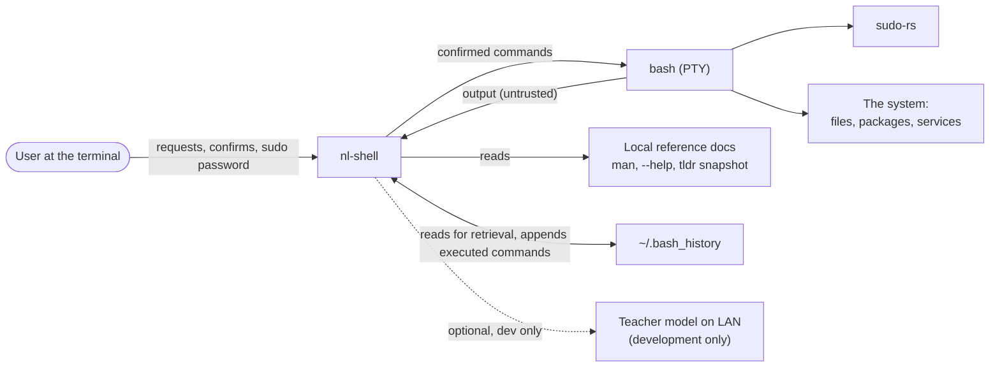

# 3. Context and scope

> Living document.

## 3.1 System context

## 3.2 External interfaces

| Interface | Direction | Trust |
|---|---|---|
| Terminal (keyboard in, screen out) | both | Input trusted; anything rendered from command output is not |
| PTY to bash | both | Commands out are gated; output in is untrusted |
| sudo prompt via the PTY | in | Passthrough only; nothing captured (ADR-0006) |
| Local reference docs | in | Local-reference taint |
| `~/.bash_history` | both | Read as trusted (it is the user's own); appended after each run |
| llama.cpp server or bindings | both | Local, no network for the command model |
| Teacher endpoint (dev only) | both | Model output from another host; not in the shipped config |

## 3.3 Out of context

No web access, no cloud APIs, no remote hosts (multi-host over SSH is backlog), no
graphical UI.
