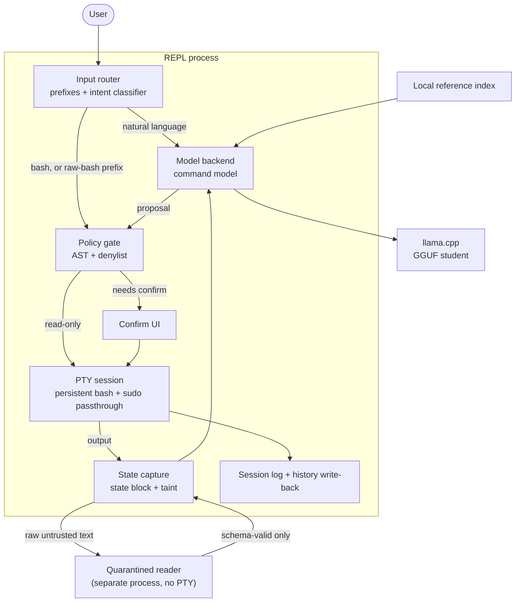

# 5. Building block view

> Living document. Components not yet built are marked *(planned)* in 5.3; they become
> real paths as M0 lands.

## 5.1 Components

| Component | Responsibility | Safety-critical |
|---|---|---|
| Input router | Prefix modes (`\`, `?`, `@`, `@@`, `:`); otherwise the intent classifier picks bash or natural language | No (a wrong route still hits the gate) |
| State capture | Builds the state block; truncates output; filters env; labels taint | Yes (taint, secrets) |
| Model backend | Builds the prompt from the editable YAML prompts; calls the command model; parses the proposal | No (its output is untrusted) |
| Policy gate | Parses and classes every command; forces confirm on taint; rejects `sudo -S` and pipes into sudo | **Yes, the most critical** |
| Confirm UI | Shows the command exactly as bash will parse it; strips escape sequences | Yes |
| PTY session | One persistent bash; completion and exit-code detection; sudo passthrough | Yes (password) |
| Quarantined reader | Reads raw untrusted text in a separate process; returns only schema-valid output | Yes |
| Session log, history | JSONL per turn; appends executed commands to `~/.bash_history`; silent during passthrough | Yes (secrets) |
| Installer | GPU detection, weight download and verification, install-time doc harvest | Yes (integrity) |

## 5.2 Build-time components (not shipped)

| Component | Responsibility |
|---|---|
| Reference VM and harvest | Ubuntu 26.04 VM with snapshots; harvests man pages, `--help`, packages, units, `/etc` defaults |
| Data pipeline | Back-translation, grounded generation, correction pairs, synthetic sessions, execution filter |
| Training | QLoRA fine-tuning of the student; intent-classifier training |
| Eval suite | The metrics in section 10, against any backend |

## 5.3 Code layout

Python package `nl_shell` under `src/`, tests under `tests/`, run with `python3 -m pytest`.

| Module | Component | Status |
|---|---|---|
| `nl_shell.cli` | Entry point (`nl-shell`, `python -m nl_shell`) | built (M0.1) |
| `nl_shell.repl` | The read loop; exit commands | built (M0.1) |
| PTY session, state capture, policy gate, confirm UI, model backend, input router, session log | — | *(planned, M0.2–M0.10)* |
