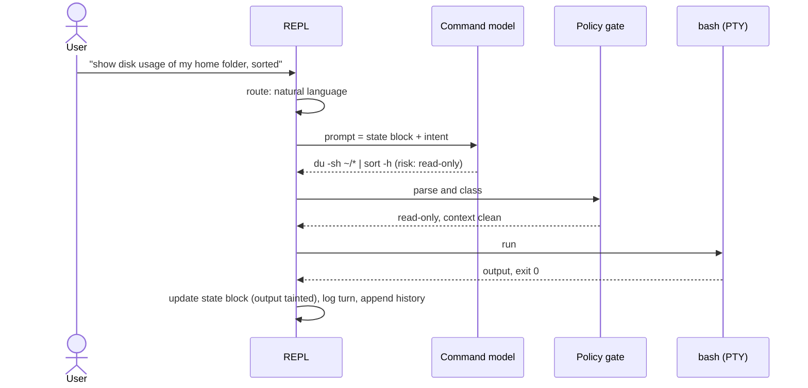

# 6. Runtime view

> Living document.

## 6.1 A natural-language request

If the gate returns mutating, destructive or privileged, or untrusted content was in context,
the REPL shows the command and waits for the user's confirm or edit before running it.

## 6.2 sudo

1. The user confirms a privileged command (the gate always asks).
2. bash runs it; sudo-rs writes its prompt to the PTY.
3. The REPL detects the prompt and switches to **passthrough**: keystrokes go straight to
   the PTY, state capture and logging stop.
4. When sudo finishes, the REPL strips the prompt line from captured output and resumes.

sudo-rs caches credentials per tty, so later sudo commands in the session usually do not
prompt.

## 6.3 Fix on failure

On a non-zero exit, the REPL offers a corrected command built from the failed command and its
(tainted) stderr. Because the context is tainted, the correction always needs a confirm.

## 6.4 The agent loop (`@@goal`)

Run → observe → propose the next step, with a confirm per step and a step limit. Every step
goes through the gate. The loop stops at the limit, on a declined confirm, or when the model
says the goal is reached.

## 6.5 Reading untrusted text

When the user asks about long output ("why did that fail?") or a file, the REPL sends the raw
text to the quarantined reader, which returns structured output such as
`{"flags": [...], "summary": "<=200 chars"}`. Only that output enters the command model's
context.
