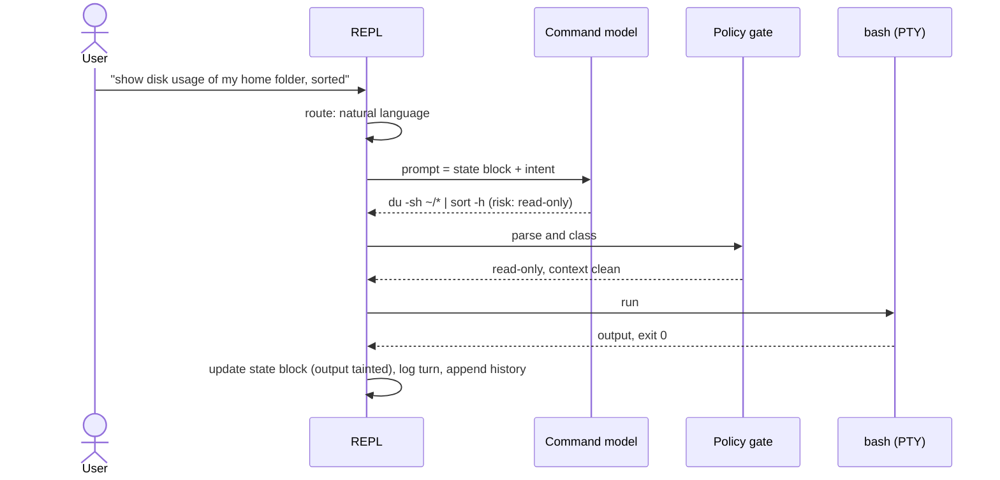

# 6. Runtime view

> Living document.

## 6.1 A natural-language request

If the gate returns mutating, destructive or privileged, or untrusted content was in context,
the REPL shows the command and waits for the user's confirm or edit before running it.

## 6.2 sudo

1. The user confirms a privileged command (the gate always asks).
2. bash runs it; sudo-rs writes the session's own prompt (`SUDO_PROMPT`, random per
   session) to the PTY.
3. Because the running command is privileged *and* the prompt matches, the REPL enters
   **passthrough**: capture stops. Keystrokes were already going to the PTY unlogged, as
   for every running command.
4. The prompt line, with its pwfeedback asterisks, is removed from captured output. The
   command's done record on the control channel ends passthrough (ADR-0014, ADR-0015).

sudo-rs caches credentials per tty. nl-shell closes the cache with a logged `sudo -k` after
the done record, so the next sudo prompts again, unless the user sets
`sudo.keep_credentials = true`; then every later confirm says the cache is warm
(ADR-0015 point 6).

## 6.3 Fix on failure

On a non-zero exit, the REPL offers a corrected command built from the failed command and its
(tainted) stderr. Because the context is tainted, the correction always needs a confirm.

## 6.4 The agent loop (`@@goal`)

Run → observe → propose the next step, with a confirm per step and a step limit. Every step
goes through the gate. The loop stops at the limit, on a declined confirm, or when the model
says the goal is reached.

## 6.5 Reading untrusted text

When the user asks about long output ("why did that fail?") or a file, the REPL sends the raw
text to the quarantined reader, which returns structured output such as
`{"flags": [...], "summary": "<=200 chars"}`. Only that output enters the command model's
context.
